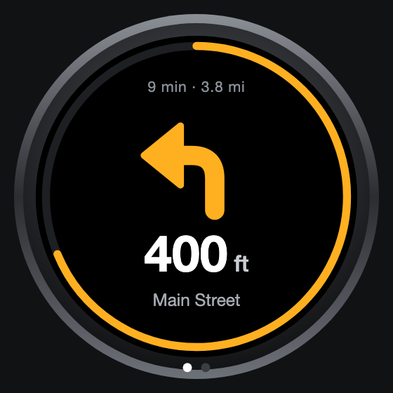
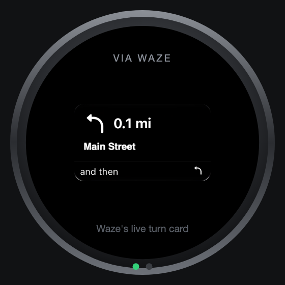

# Sambar Gauge Pod

A round 52 mm gauge for a 1992 Subaru Sambar kei truck that shows turn-by-turn directions (Waze, Apple Maps, Google Maps), music, and eventually engine RPM, all driven by the phone's wireless CarPlay.

**See the one-sheet:** https://flattery89.github.io/sambar-gauge-pod/

  
  
  

